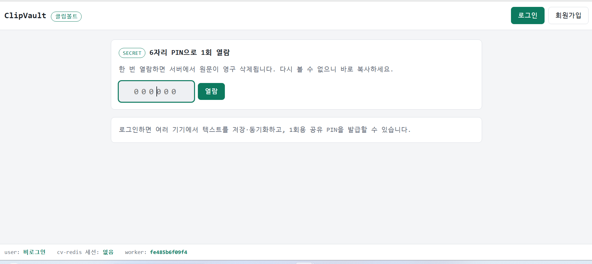
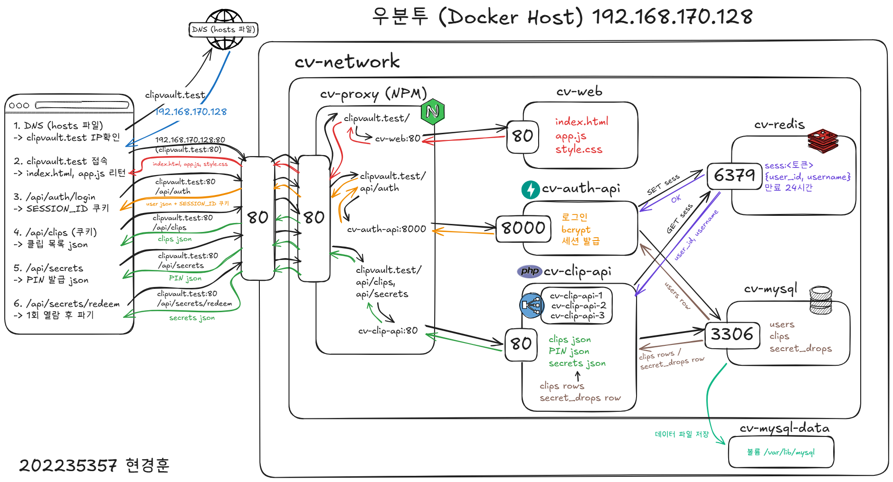
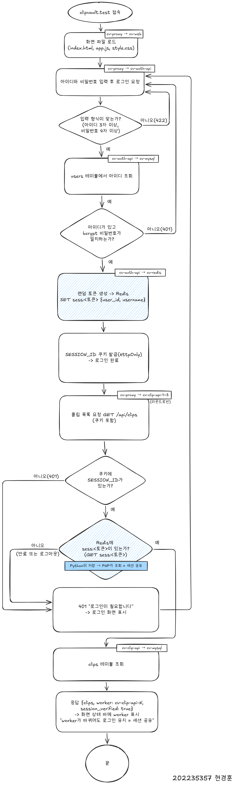
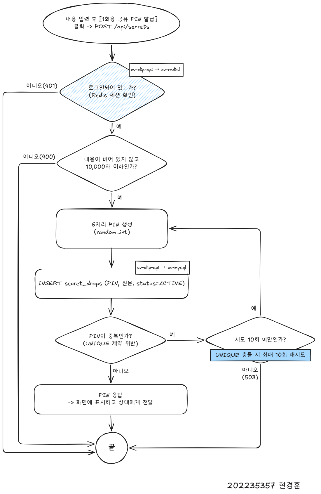
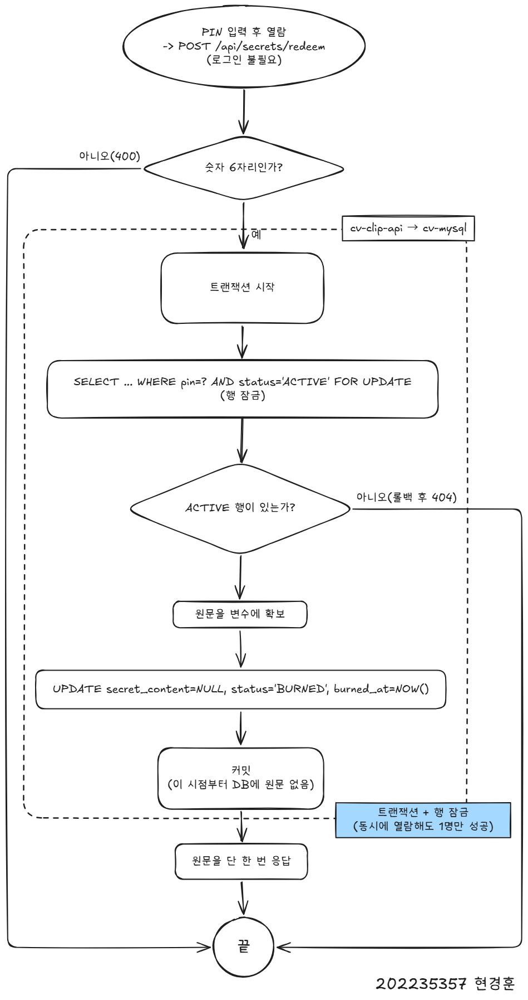
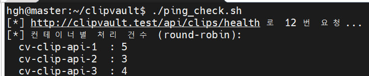
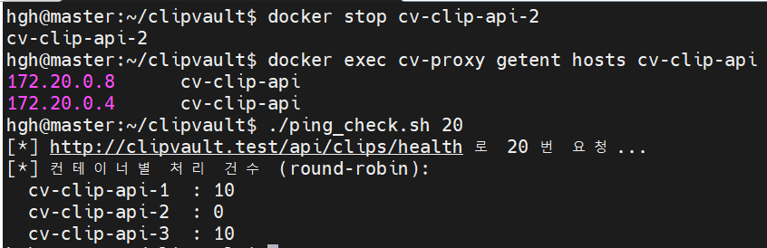
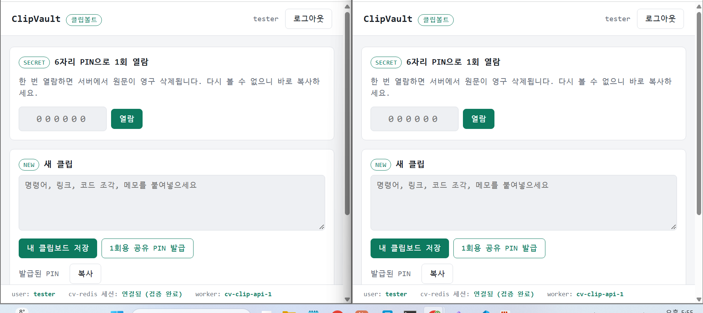
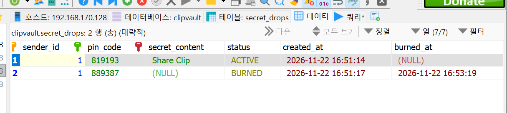

# ClipVault

> Docker 기반 마이크로서비스 웹 클립보드 서비스

로그인하면 어느 기기에서든 텍스트 조각(클립)을 저장하고 꺼내 쓸 수 있는 웹 클립보드입니다.
로그인 없이 6자리 PIN으로 **딱 한 번만** 열어 볼 수 있는 1회용 공유 기능을 함께 제공하며, 열람 즉시 원문은 DB에서 파기됩니다.

- 결과 보고서: [ClipVault_포트폴리오.docx](docs/ClipVault_포트폴리오.docx)
- Docker Hub: [cv-web](https://hub.docker.com/r/hgh040700/cv-web) · [cv-auth-api](https://hub.docker.com/r/hgh040700/cv-auth-api) · [cv-clip-api](https://hub.docker.com/r/hgh040700/cv-clip-api)



## 만든 이유

파일은 Send Anywhere로 주고받았지만 텍스트는 공유하기가 어려워, 매번 카카오톡 '나에게 보내기'로 옮기는 게 번거로웠습니다.
텍스트를 기기 간에 바로 옮기고, 필요하면 한 번만 보여 주고 사라지게 하는 서비스를 직접 만들었습니다.

## 주요 기능

| 기능 | 설명 | 로그인 |
| --- | --- | --- |
| 회원가입 · 로그인 · 로그아웃 | bcrypt 비밀번호 해시, Redis 세션 + `SESSION_ID` HttpOnly 쿠키 | 불필요 |
| 클립 저장 · 조회 · 삭제 | 내 계정의 클립만 목록으로 관리, 원클릭 복사 | 필요 |
| 1회용 PIN 발급 | 텍스트를 6자리 PIN과 함께 저장 | 필요 |
| PIN 열람 후 파기 | 한 번 열람하면 원문을 즉시 `NULL`로 지우고 `BURNED` 처리 | 불필요 |
| 처리 서버 표시 | 화면 하단에 요청을 처리한 컨테이너(`worker`) 표시 | 필요 |

## 아키텍처



| 컨테이너 | 역할 | 이미지 | 내부 포트 | 호스트 공개 |
| --- | --- | --- | --- | --- |
| `cv-proxy` | 역방향 프록시 | jc21/nginx-proxy-manager | 80, 81 | 80, 81 |
| `cv-web` | 프론트 (정적 파일) | hgh040700/cv-web | 80 | - |
| `cv-auth-api` | 인증 서버 (Python FastAPI) | hgh040700/cv-auth-api | 8000 | - |
| `cv-clip-api-1~3` | 클립 서버 (PHP) × 3 | hgh040700/cv-clip-api | 80 | - |
| `cv-redis` | 세션 저장소 | redis:7 | 6379 | - |
| `cv-mysql` | DB (볼륨 `cv-mysql-data`) | mysql:8.0 | 3306 | 33306 |

- 외부 진입점은 `cv-proxy`의 80번 포트 하나뿐이고, 나머지는 `cv-network` 내부에서 **컨테이너 이름(내장 DNS)** 으로 통신합니다.
- 경로별 분기: `/` → `cv-web`, `/api/auth` → `cv-auth-api`, `/api/clips` · `/api/secrets` → `cv-clip-api`
- 클립 서버 3대는 네트워크 별칭 `cv-clip-api` 를 공유해, 프록시가 라운드로빈으로 분산합니다.

## 핵심 설계

### 1. 이기종 서버 간 세션 공유

로그인은 **Python** 인증 서버가, 클립 조회는 **PHP** 클립 서버가 처리합니다. 두 서버는 서로 호출하지 않고 **Redis만 공유**합니다.

| 규칙 | 값 |
| --- | --- |
| 쿠키 | `SESSION_ID` (HttpOnly, SameSite=Lax) |
| Redis 키 | `sess:<token>` (TTL 86400초) |
| Redis 값 | `{"user_id": 1, "username": "..."}` |

세션이 서버 밖에 있으므로 클립 서버는 **무상태(stateless)** 가 되고, 같은 이미지로 3대로 늘려도 로그인이 그대로 유지됩니다.



### 2. 1회 열람 후 파기 (동시성 제어)

열람 요청은 트랜잭션 안에서 `SELECT ... FOR UPDATE` 로 행을 잠근 뒤, 원문을 읽고 같은 트랜잭션에서 `secret_content = NULL, status = 'BURNED'` 로 바꿉니다.
두 사람이 같은 PIN으로 동시에 요청해도 **한 명만 성공**합니다.

| PIN 발급 | PIN 열람 후 파기 |
| --- | --- |
|  |  |

### 3. 로드밸런싱과 장애 대응

`scripts/ping_check.sh` 로 12번 요청하면 3대가 나눠 처리하고(5 / 3 / 4), 한 대를 멈추면 나머지 2대가 처리합니다(10 / 0 / 10, 실패 0건).

| 분산 | 한 대 정지 |
| --- | --- |
|  |  |

## 기술 스택

| 구분 | 기술 |
| --- | --- |
| 프론트엔드 | HTML, CSS, Vanilla JavaScript (Fetch API), Nginx |
| 백엔드 | Python 3.11 · FastAPI · pymysql · redis-py · bcrypt / PHP 8.2 · Apache · PDO · phpredis |
| 데이터 | MySQL 8.0, Redis 7 |
| 인프라 | Docker (CLI, Compose 미사용), Nginx Proxy Manager, Ubuntu (x86_64) |

## 실행 방법

Docker가 설치된 Linux(x86_64) 기준입니다.

```bash
git clone https://github.com/HyeonGyeongHoon/clipvault.git
cd clipvault
cp .env.example .env          # 비밀번호 수정
chmod +x scripts/*.sh

./scripts/run.sh              # 컨테이너 8개 실행 (Docker Hub 이미지 사용)
./scripts/restore.sh mysql/init.sql   # 처음 실행 시 스키마 생성
```

직접 빌드하려면 `./scripts/build.sh` 를 먼저 실행합니다. (`--push` 를 붙이면 Docker Hub 업로드)

### 프록시 설정 (Nginx Proxy Manager)

`http://<서버_IP>:81` 에 접속해 **Hosts › Proxy Hosts › Add Proxy Host** 에 아래처럼 등록합니다.

| 위치 | 대상 |
| --- | --- |
| Domain Names | `clipvault.test` |
| Details (기본) | `http` / `cv-web` / `80` |
| Custom location `/api/auth` | `http` / `cv-auth-api` / `8000` |
| Custom location `/api/clips` | `http` / `cv-clip-api` / `80` |
| Custom location `/api/secrets` | `http` / `cv-clip-api` / `80` |

> Forward Hostname 끝에 `/` 를 붙이면 경로 접두어가 잘려 404가 납니다. API가 전체 경로를 라우트로 쓰기 때문에 슬래시 없이 입력합니다.

접속할 PC의 hosts 파일에 `<서버_IP> clipvault.test` 를 추가한 뒤 `http://clipvault.test` 로 접속합니다.

### 백업과 복원

```bash
./scripts/backup.sh                         # backup/clipvault_날짜.sql 생성
./scripts/restore.sh backup/clipvault_xxx.sql
```

### 정리

```bash
./scripts/stop.sh            # 컨테이너 + 네트워크 삭제 (데이터 유지)
./scripts/stop.sh --purge    # 볼륨까지 삭제
```

## 검증

| 항목 | 방법 | 결과 |
| --- | --- | --- |
| 세션 공유 | 로그인 후 클립 새로고침 반복 | worker가 `cv-clip-api-1/2/3` 으로 바뀌어도 로그인 유지 |
| 데이터 영속성 | `docker restart cv-mysql`, `docker rm` → `docker run` | 기존 회원 · 클립 유지 |
| 1회 열람 | 같은 PIN 2회 열람 | 2회차 404, DB 원문 `NULL` / `BURNED` |
| 분산 · 장애 | `scripts/ping_check.sh` | 3대 분산, 1대 정지 시 실패 0건 |

| 세션 공유 (worker 변경) | 열람 후 DB |
| --- | --- |
|  |  |

## 트러블슈팅

| 문제 | 원인 | 해결 |
| --- | --- | --- |
| `/api/auth/login` 404 | NPM Forward Hostname 끝 `/` 로 경로 접두어 제거 | 슬래시 없이 `cv-auth-api` 입력 |
| 컨테이너 재생성 후 502 | NPM(nginx)이 기동 시 풀어 둔 예전 IP로 요청 | `docker exec cv-proxy nginx -s reload` |
| `init.sql` 실행 시 1227 오류 | 권한 없는 `cvuser` 로 `CREATE USER` 실행 | 계정은 `MYSQL_USER` 로 자동 생성, 스크립트에서 제거 |
| pymysql · PDO 인증 실패 | MySQL 8 기본 인증 플러그인 | `--default-authentication-plugin=mysql_native_password`, 태그 `8.0` 고정 |
| HTTP 접속에서 복사 버튼 실패 | `navigator.clipboard` 는 보안 컨텍스트 전용 | `document.execCommand('copy')` 대체 코드 |

## 프로젝트 구조

```
clipvault/
├── auth-api/          # 인증 서버 (FastAPI)
│   ├── Dockerfile
│   ├── requirements.txt
│   └── main.py
├── clip-api/          # 클립 서버 (PHP + Apache)
│   ├── Dockerfile
│   ├── apache.conf
│   └── src/           # index.php(라우터), clips.php, secrets.php, redis_session.php, db.php
├── web/               # 프론트 (HTML · CSS · JS, Nginx)
├── mysql/init.sql     # 스키마 (users, clips, secret_drops)
├── scripts/           # run · stop · build · backup · restore · ping_check
├── docs/              # 구성도·플로우 차트(.png / .excalidraw 원본), 스크린샷, 결과 보고서
└── .env.example
```

## 앞으로

- 텍스트뿐 아니라 파일도 같은 방식으로 공유
- 실습용 VM이 아닌 실제 서버에 배포하고 HTTPS 적용

---

현경훈 · 가천대학교 컴퓨터공학부
